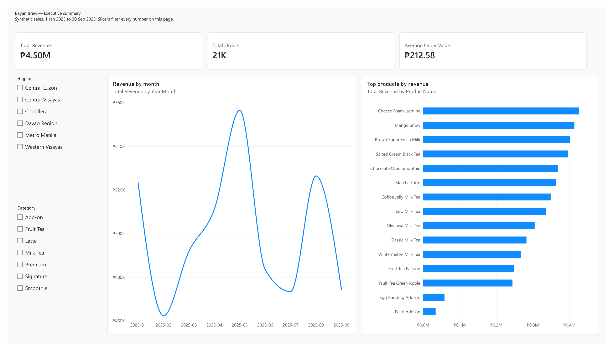
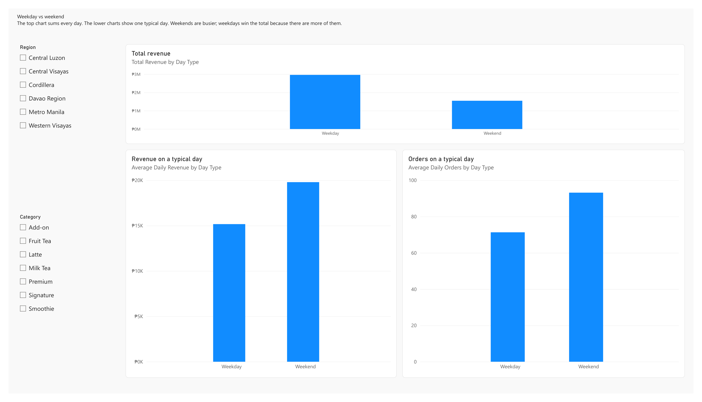

# Bayan Brew — Sales Performance Dashboard

I built this Power BI report to answer two questions for a Philippine milk tea chain: which stores and products contribute most to revenue, and how weekends compare with weekdays.

Bayan Brew is a fictional brand. Store-level sales for chains such as this are not public, so I used a synthetic point-of-sale dataset with peso prices, mall locations, and a weekend traffic pattern, then treated the file as a client engagement: define the question, model the data, check the totals, and ship the report.

**Tools:** Power BI Desktop, Power Query, DAX, AI-assisted development.

A PDF of both pages is in [projects/BayanBrew-report.pdf](projects/BayanBrew-report.pdf).

## What I did

- Defined the business question and the grain of the data: one row per line on a receipt.
- Used a synthetic point-of-sale dataset with peso prices, mall stores, and heavier weekend traffic. A fixed seed keeps the file reproducible.
- Modeled a star schema and wrote six measures. Transactions are the fact table. Stores, products, and a date table are the dimensions, and filters flow from the dimensions into the fact table.
- Built the Power Query steps, the measures, and two report pages in Power BI Desktop.
- Refreshed the data and checked the report totals against the source file.

## What the report shows

| Page | Contents |
| --- | --- |
| Executive summary | Total revenue, orders, and average order value; revenue by month; products ranked by revenue |
| Weekday vs weekend | Total revenue by day type, revenue on a typical day, and orders on a typical day |

Weekdays bring in more money in total because the calendar has 195 weekdays and 78 weekend days. A typical weekend day is the busier day: about 30% more revenue and more orders. The average ticket stays near ₱213, so the weekend lift is more orders, not higher prices.

Metro Manila, five of the ten stores, accounts for about half of revenue (₱2.31 million of ₱4.50 million).

## Data

| Item | Value |
| --- | --- |
| Grain | One row per line on a receipt. One order can contain several lines. |
| Transactions | 37,406 lines |
| Orders | 21,182 receipts |
| Stores | 10, across Metro Manila and five other regions |
| Products | 15 menu items |
| Dates | 1 January 2025 through 30 September 2025 |
| Currency | Philippine pesos |

Column definitions are in `data/bayan-brew/bayan-brew-data-dictionary.md`. The transactions can be regenerated from `data/bayan-brew/generate_transactions.py` (seed `20261001`).

## Measures

| Measure | Definition |
| --- | --- |
| Total Revenue | Sum of line revenue |
| Total Orders | Distinct receipt count |
| Average Order Value | Total Revenue divided by Total Orders |
| Total Quantity | Sum of units |
| Average Daily Revenue | Total Revenue divided by the number of dates in the filter |
| Average Daily Orders | Total Orders divided by the number of dates in the filter |

## Open the report

Open `projects/BayanBrew.pbip` in Power BI Desktop. If the visuals are empty, choose **Home → Refresh**.

## Check figures

All regions, no slicer selected.

| Check | Value |
| --- | --- |
| Total Revenue | ₱4,502,936.70 |
| Total Orders | 21,182 |
| Average Order Value | ₱212.58 |
| Metro Manila revenue | ₱2,305,496.75 |
| Weekday total revenue | ₱2,958,515.70 |
| Weekend total revenue | ₱1,544,421.00 |
| Revenue on a typical weekday | about ₱15,172 |
| Revenue on a typical weekend day | about ₱19,800 |
